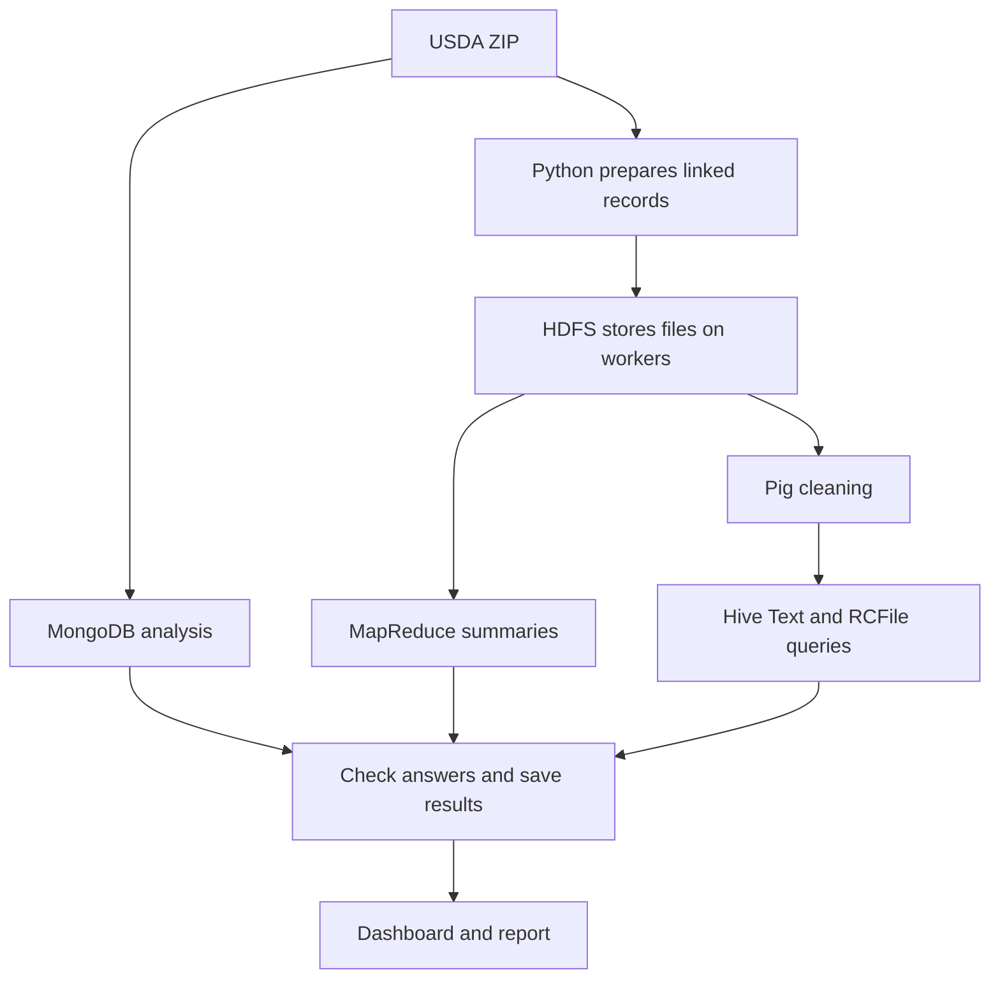

# What is this project actually doing?

We take USDA food data, calculate nutrition summaries using several tools, check
that their answers agree, and compare how quickly they work and how much space
they use. The dashboard lets us see the saved answers and measurements.

## Follow one record through the project

A food has an ID, description and type. Its nutrient measurements live in another
CSV. We connect them using the food ID, then connect the nutrient ID to its name
and unit. For example, a protein observation belongs to a particular food and has
an amount measured in grams.

We group observations by food type and nutrient ID, then calculate how many
observations there are, their total and their average. We never add protein and
sodium together or mix different units. These averages describe the data; they
are not dietary advice or necessarily averages per 100 g.

## Why do we use so many tools?

| Tool | Its job in our project |
| --- | --- |
| Python + SQLite | Read the CSVs in manageable pieces and connect food/nutrient records without loading everything into RAM. |
| MongoDB | Store the original CSV records as documents, connect foods to nutrients and calculate summaries. |
| MongoDB indexes | Help find a food without checking every document. We measure both approaches. |
| HDFS | Store files across the workers, keeping two copies for this setup. |
| YARN | Decide which worker runs each processing task. |
| MapReduce | Workers process portions of the input; reducers combine observations into counts, totals and averages. |
| Pig | Clean the prepared records, including filtering negative nutrient amounts from the analysis. |
| Hive | Run SQL-style questions on the cleaned data. Compare normal Text storage with compressed RCFile storage. |
| Flask | Show the saved results in a browser without keeping all those services running. |

## How are the machines connected?

The **master** coordinates file locations and processing jobs. **Worker 1 and
worker 2** store data and execute tasks. MongoDB is a separate service on the
master; we have not set up a sharded MongoDB cluster.

On your laptop, Docker creates three separate software containers playing these
roles. They still share your laptop's RAM and disk. At college, the roles run on
three actual machines.

## How do we know the answers are right?

We count input, rejected and cleaned records; independently calculate expected
summaries; then compare counts, totals and averages with MongoDB, MapReduce and
Hive. We also save the ZIP's SHA-256: a fingerprint that identifies the file used.
Timing comparisons exclude initial Hive warmups and show how many measurements
were taken. Faster results are useful only if the answers still match.

## What have we finished?

The entire ZIP was prepared and imported into MongoDB: 2,063,876 foods and
26,848,323 nutrient observations. All three themes passed on the linked
**10,000-food development subset**, and the dashboard works. That subset contains
mostly branded foods, so it does not represent every food type equally.

The final full-data analysis, measurements on three college machines, and report/
demo evidence are still pending. A successful small run does not prove that a
larger run will fit in memory or finish without issues.

Key files: `fdc/prepare.py` prepares data; `fdc/mongo.py` handles MongoDB;
`mapreduce/`, `pig/` and `hive/` contain the processing jobs; `fdc/part1.py` runs
the full workflow; `fdc/report.py` checks results; `fdc/dashboard.py` shows them.
