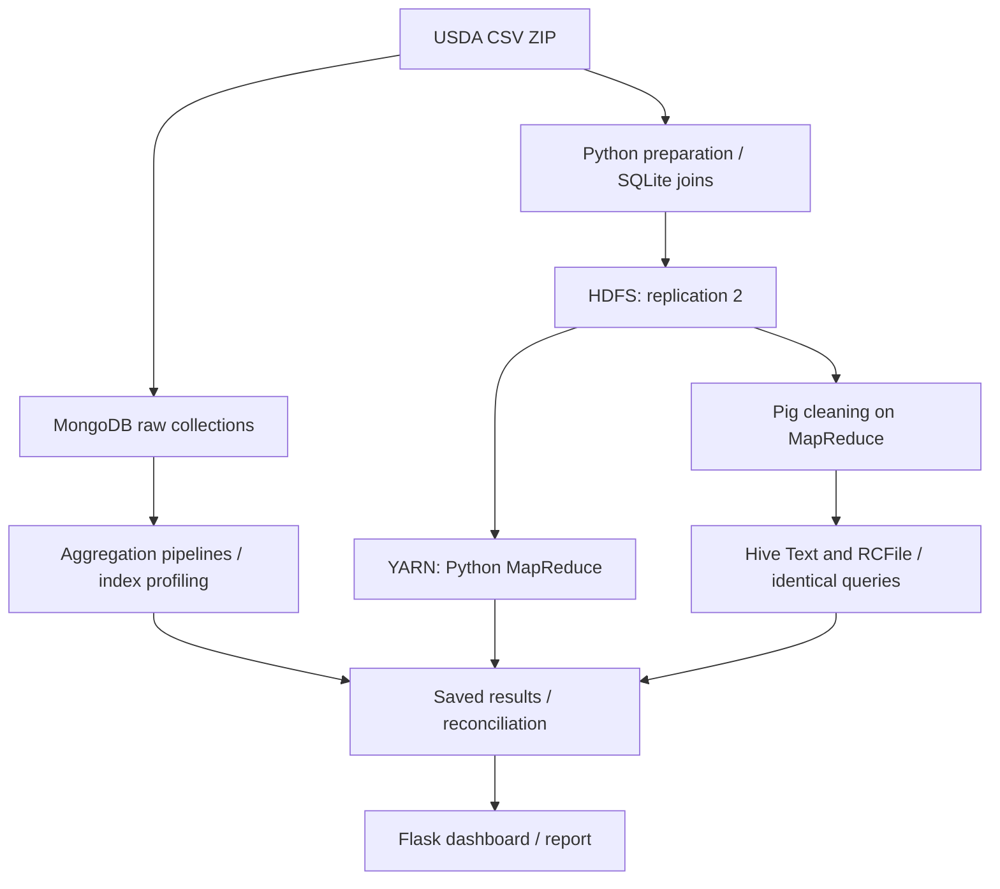

# Project architecture and operation

**Dataset:** USDA FoodData Central, October 31, 2024. Full preparation found
2,063,876 foods and 26,848,323 nutrient observations. Development uses a labelled,
linked 10,000-food subset; it is not representative sampling.

| Component | What it does |
| --- | --- |
| `fdc/prepare.py` | Streams CSVs, joins dimensions using disk-backed SQLite, writes TSV and rejection accounting. |
| `fdc/mongo.py` | Imports all CSVs; builds linked food documents; runs aggregation and indexed/unindexed query profiling. |
| `mapreduce/` | Mapper emits nutrient observations; reducers calculate counts, sums and means by food type/nutrient. |
| `pig/`, `hive/` | Pig removes unusable/negative analytical rows; Hive compares identical queries on Text and compressed RCFile. |
| `fdc/part1.py`, `fdc/report.py` | Orchestrate full execution, reconcile results and generate an evidence-based report. |
| `fdc/dashboard.py` | Displays saved scope, nutrient results, timings and storage; no live database/cluster needed. |

**Deployment:** master runs NameNode, ResourceManager, JobHistory and analytics
services. Two workers run DataNodes and NodeManagers; YARN schedules computation,
while HDFS stores replicated input/output. MongoDB is a separate service, not a
Hadoop job or a claimed sharded deployment. Laptop Docker containers model these
roles; final execution uses three physical college systems.

**Correctness:** retain source SHA-256; account for source/rejected/clean rows;
compare group counts, sums and means across systems; exclude warmups from Hive
medians. Keep raw evidence, scope labels and cluster identity. Never compare
amounts across different nutrients/units or present subset timings as full-data
benchmarks.

**Current state:** full preparation/import and subset cross-system checks passed;
dashboard implemented. Full-data analytics, physical-cluster evidence and final
submission report/demo remain pending.
